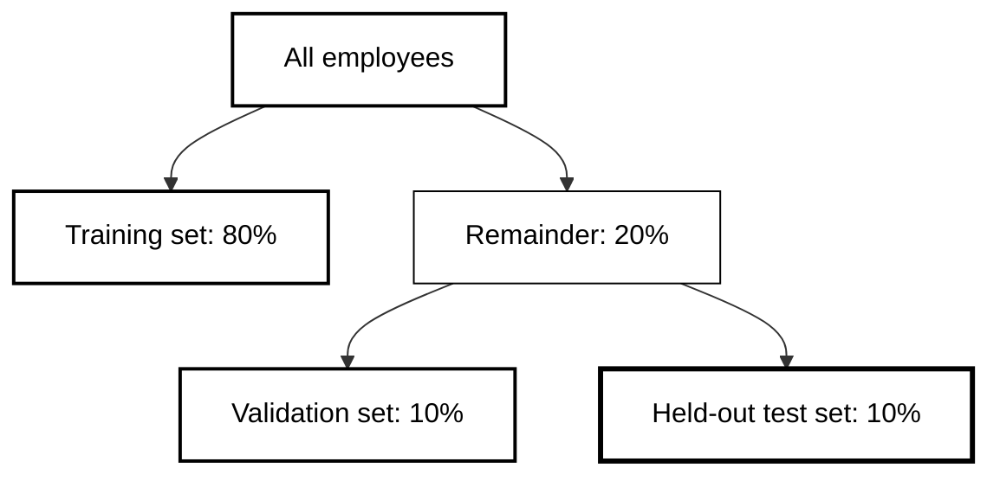

---
jupytext:
  text_representation:
    extension: .md
    format_name: myst
    format_version: 0.13
    jupytext_version: 1.19.6
kernelspec:
  display_name: Python 3
  language: python
  name: python3
---

# Workshop 7: Production Grade Classification

**Programme:** Corndel AI6 Level 6 ML Engineer Apprenticeship
**Unit:** 7 Supervised Machine Learning
**Estimated time:** 5 hours (coach-facilitated session)

---

## Learning Objectives

By the end of this notebook, you will be able to:

- Explain why accuracy misleads on an imbalanced dataset, and choose a metric that reflects the cost of failure
- Correct class imbalance and set a decision threshold you can justify in terms of the people affected
- Use SHAP and a legal and ethical check to decide which features belong in a model
- Track, save and serve a model through an API, and document it in a model card
- Stress-test a model on unusual cases and say what offline evaluation cannot tell you

---

## Context

You are an ML engineer at a mid-sized technology company. The HR director has asked the team to predict which employees are at risk of leaving. The problem is harder than it looks, because a model can score well and still fail the people it is meant to help.

In this workshop, "production grade" describes the classification model itself. Could it survive professional scrutiny? That means rigorous evaluation, honest handling of class imbalance, explainability, ethical feature decisions and documentation that someone other than you can read. The wider deployment pipeline (CI/CD, container orchestration and monitoring) is outside the scope of this session.

+++

---

## How to Use This Notebook

The notebook has eleven Parts in four phases: **Build** (Parts 1 to 4), **Decide** (Parts 5 and 6), **Ship** (Parts 7 to 9) and **Defend** (Parts 10 and 11). Run the cells in order with Shift+Enter. Each Part follows the same rhythm: a short explanation, a worked example that you run and read, then a task for you.

Every task has a hint, a solution you can open if you are stuck, and a check cell that tells you whether you have it right. Throughout the notebook, coloured boxes signal different types of content: <div class="alert alert-block alert-warning">**yellow** boxes are reminders connecting the work to your broader learning</div> <div class="alert alert-block alert-info">**blue** boxes help you to reflect on what just happened and put it in a wider context</div> <div class="alert alert-block alert-success">**green** boxes are tasks for you to complete</div>

+++

### Importing Libraries

Run the cell below first. It checks that `utils.py`, the helper file for this workshop, sits next to the notebook, then loads the libraries. If a window asks you to select a kernel, choose **Python Environments**, then the entry labelled `Python 3.12` with the path `/usr/local/bin/python`. Do not choose **Create Python Environment**, even though it is marked as recommended.

```{code-cell} ipython3
import os

if not os.path.exists('utils.py'):
    raise FileNotFoundError(
        'utils.py is missing. Open the full repository in a Codespace so '
        'that utils.py sits next to this notebook. Expected location: '
        + os.path.abspath('utils.py'))

import warnings

import numpy as np
import pandas as pd
import xgboost as xgb
from IPython.display import display
from sklearn.metrics import (
    accuracy_score, confusion_matrix, f1_score, recall_score,
    roc_auc_score,
)
from sklearn.model_selection import train_test_split

import utils

warnings.filterwarnings('ignore')
print('Libraries loaded.')
```

+++

### Choose Where Your Runs Are Recorded

Every model you train today is saved as a **run**: its settings and its scores. Runs are always saved to a local file, `runs_log.csv`. If you set up a [Weights & Biases](https://wandb.ai) account in the pre-work, they are also sent to your W&B dashboard.

When you run the next cell in `wandb` mode, a prompt appears in the search bar at the top of the Codespaces window, not inside the notebook. Choose option 2 (use an existing account) and paste your API key. If you press Escape, or the login fails, tracking falls back to the local file and the notebook carries on.

![A dark screenshot of the Codespaces window. A yellow hand-drawn oval circles the search bar at the top of the window, which reads AI6-W7 [Codespaces: expert guide]. The word input is written above it in blue. Below the search bar, the notebook toolbar shows Run All, Restart and Clear All Outputs, and the breadcrumb path ends at a cell containing an input prompt. The image shows that when a cell asks you to type something, the prompt appears in the search bar at the top of the window, not in the notebook itself.](wandb_login_location.png)

```{code-cell} ipython3
# Use 'wandb' to log to your dashboard, or 'local' to skip the account
TRACKING_MODE = 'wandb'
utils.configure_tracking('ai6-7w-hr-attrition', mode=TRACKING_MODE)
```

+++

---

## Part 1: Meet and Prepare the Data

Everything in this workshop follows one question: could a model that predicts employee attrition survive professional scrutiny? This Part loads the data, shows you the first problem to solve, and prepares the inputs for training.

+++

### Understanding the Dataset

The IBM HR Analytics dataset has one row for each employee. The column `Attrition` records whether the employee left. The dataset is fictional, created by IBM data scientists and widely used for teaching, so treat the people in it as if they were real.

```{code-cell} ipython3
df = pd.read_csv('ibm_attrition.csv')
print(f'{df.shape[0]} employees, {df.shape[1]} columns')
display(df.head(3))
```

+++

Each row mixes numeric columns, such as `MonthlyIncome`, with text columns, such as `Department`. XGBoost, the model you will use, reads numbers only, so you will encode the text columns shortly. First, check how many employees left.

```{code-cell} ipython3
utils.plot_class_distribution(df)
```

+++

Most employees stayed. This is **class imbalance**: one outcome is much rarer than the other, and a model can score well by almost always predicting the common one. You will see this happen in Part 2.

+++

### Encode the Target

The `Attrition` column holds the words 'Yes' and 'No'. A model needs a number: 1 for an employee who left and 0 for one who stayed.

<div class="alert alert-block alert-success">
<b>Your turn:</b><br>
Replace the right-hand side of the line below so that <code>Attrition</code> holds 1 for 'Yes' and 0 for 'No', as integers.

<details>
<summary>Click here for a hint</summary>

Compare each value with the string `'Yes'`. The comparison gives True or False. Convert that to integers with `.astype(int)`.

</details>
</div>

```{code-cell} ipython3
# Your code here
df['Attrition'] = df['Attrition']
```

+++

<details>
<summary>Click here for the solution</summary>

```python
df['Attrition'] = (df['Attrition'] == 'Yes').astype(int)
```

Two tempting alternatives fail. `df['Attrition'].astype(int)` raises an error, because 'Yes' and 'No' are not numbers. `df['Attrition'].map({'Yes': 1})` runs, but it turns every 'No' into a missing value.

</details>

```{code-cell} ipython3
utils.check_target(df)
```

+++

The next cell encodes the remaining text columns and separates the inputs (`X`) from the target (`y`).

```{code-cell} ipython3
# Turn each text category into a numeric code XGBoost can read
for col in df.select_dtypes(include=['object', 'string']).columns:
    df[col] = df[col].astype('category').cat.codes

# These columns identify people or never vary, so they carry no signal
df = df.drop(columns=['EmployeeCount', 'EmployeeNumber', 'Over18',
                      'StandardHours'], errors='ignore')
X, y = df.drop(columns='Attrition'), df['Attrition']
print(f'{X.shape[1]} features. {y.mean():.1%} of employees left.')
```

+++

### Split the Data into Three Sets

You will split the data into a training set, a validation set and a held-out test set. The diagram shows how.



+++

The training set teaches the model. The validation set is where you make decisions: you tune the threshold, run SHAP and compare models. Those decisions shape the model, so scores on the validation set are slightly optimistic. The held-out test set stays untouched until Part 10, which gives you one honest score. In code, the split happens in two stages: first separate the training data from the rest, then split the rest in half.

+++

<div class="alert alert-block alert-warning">
<b>Reminder:</b> Choosing and defending an evaluation method is part of <b>K19</b>, problem-solving through test data analysis. Keep the held-out test set out of every decision until Part 10.
</div>

+++

Use [`train_test_split`](https://scikit-learn.org/stable/modules/generated/sklearn.model_selection.train_test_split.html) from **scikit-learn** to take the first 20% of employees out as the remainder. Because only a minority of employees left, a purely random split can leave one set with a different share of leavers from the other.

<div class="alert alert-block alert-success">
<b>Your turn:</b><br>
Add one argument to <code>train_test_split</code> so that the training set and the remainder keep the same share of leavers.

<details>
<summary>Click here for a hint</summary>

The argument is named after the idea of sampling each class in proportion. It takes the column whose proportions you want to keep.

</details>
</div>

```{code-cell} ipython3
# Your code here
X_train, X_rest, y_train, y_rest = train_test_split(
    X, y, test_size=0.2, random_state=42,
)
```

+++

<details>
<summary>Click here for the solution</summary>

```python
X_train, X_rest, y_train, y_rest = train_test_split(
    X, y, test_size=0.2, random_state=42, stratify=y,
)
```

The argument is `stratify=y`. Without it, the function ignores the target and the leaver share can drift between the two sets. Passing only `X` fails, because the function needs `y` to split the target alongside the inputs.

</details>

```{code-cell} ipython3
utils.check_split(X, y, X_train, y_train)
```

+++

Now split the remainder into the validation set and the held-out test set.

```{code-cell} ipython3
# Stratify again so both halves keep the same share of leavers
X_val, X_test, y_val, y_test = train_test_split(
    X_rest, y_rest, test_size=0.5, random_state=42, stratify=y_rest)
print(f'Training {len(X_train)}, validation {len(X_val)}, '
      f'held-out test {len(X_test)}')
```

+++

The encoding above happens before the split, to keep the example short. In a production pipeline you would fit the encoder on the training data only and apply it to the other sets afterwards. The notes in `going_further.md` show the `Pipeline` approach.

+++

---

## Part 2: The Accuracy Trap

Part 1 showed that most employees stayed. This Part trains a model without correcting for that, and shows why a high accuracy score can hide a model that has learned very little.

+++

### Train a Baseline

Start with **XGBoost**, a model that builds many small decision trees in sequence, each one correcting the errors of the last. The cell below uses [`XGBClassifier`](https://xgboost.readthedocs.io/en/stable/python/python_api.html#xgboost.XGBClassifier) at its default settings. Do not change any parameters.

```{code-cell} ipython3
model_naive = xgb.XGBClassifier(random_state=42, eval_metric='logloss',
                                verbosity=0)
model_naive.fit(X_train, y_train)
y_pred_naive = model_naive.predict(X_val)
print(f'Accuracy: {accuracy_score(y_val, y_pred_naive):.1%}')
```

+++

<div class="alert alert-block alert-info">
<b>Predict before you run the next cell</b><br>
Look at the class distribution from Part 1. If a model predicted 'stayed' for every employee, what accuracy would it score, and how would that compare with the model you just trained?
</div>

```{code-cell} ipython3
always_stayed = np.zeros(len(y_val), dtype=int)
print(f'Always predicting stayed: {accuracy_score(y_val, always_stayed):.1%}')
print(f'Your trained model:       {accuracy_score(y_val, y_pred_naive):.1%}')
```

+++

A model that has learned nothing scores as well as the one you trained, or better. Accuracy rewards the common outcome. The confusion matrix shows where the model actually fails.

```{code-cell} ipython3
utils.plot_confusion_matrix(y_val, y_pred_naive, title='Naive model')
```

+++

Look at the bottom-left cell, outlined in red. It counts employees who left but whom the model predicted would stay: the **false negatives**. If that number is close to the number of leavers, the model has largely ignored the minority class. High accuracy alongside weak **recall** (the share of real leavers the model catches) is the **accuracy trap**.

+++

<div class="alert alert-block alert-warning">
<b>Reminder:</b> Choosing a metric that fits the business cost of failure is <b>K7</b>, performance metric selection in business context. This Part is the evidence for it.
</div>

+++

Recall is the metric this Part points toward. You can calculate it from the confusion matrix.

<div class="alert alert-block alert-success">
<b>Your turn:</b><br>
Replace <code>None</code> with the recall of the naive model: the leavers it caught divided by all the leavers.

<details>
<summary>Click here for a hint</summary>

The leavers it caught are the true positives (`tp`). All the leavers are the true positives plus the false negatives (`fn`).

</details>
</div>

```{code-cell} ipython3
# Your code here
tn, fp, fn, tp = confusion_matrix(y_val, y_pred_naive).ravel()
recall = None
```

+++

<details>
<summary>Click here for the solution</summary>

```python
recall = tp / (tp + fn)
```

</details>

```{code-cell} ipython3
utils.check_recall(recall, y_val, y_pred_naive)
```

+++

Record this run so you can compare it with later ones.

```{code-cell} ipython3
utils.log_run('01_naive', model_naive, X_val, y_val, y_pred_naive,
              config={'scale_pos_weight': 1, 'threshold': 0.5})
```

+++

---

## Part 3: Fix the Class Imbalance

The naive model barely noticed the leavers, because there are far fewer of them. This Part tells the model to pay more attention to them with a single parameter.

+++

### Weight the Minority Class

XGBoost has a parameter called [`scale_pos_weight`](https://xgboost.readthedocs.io/en/stable/parameter.html) that makes each positive row (a leaver) count for more during training. The right value is the ratio of stayers to leavers: how many 'stayed' rows exist for each 'left' row. Using that ratio makes the training data feel balanced to the model.

<div class="alert alert-block alert-success">
<b>Your turn:</b><br>
Replace <code>None</code> with the ratio of stayers (0) to leavers (1) in <code>y_train</code>.

<details>
<summary>Click here for a hint</summary>

Count each group with a comparison and `.sum()`, for example `(y_train == 0).sum()`. Then divide one count by the other. The answer should be above 1.

</details>
</div>

```{code-cell} ipython3
# Your code here
pos_weight = None
```

+++

<details>
<summary>Click here for the solution</summary>

```python
pos_weight = (y_train == 0).sum() / (y_train == 1).sum()
```

The two common mistakes both give the wrong ratio. Dividing leavers by stayers gives a number below 1, which tells the model to ignore leavers even more. Dividing the total rows by the leavers gives a number that is too large by one, because it also counts the leavers themselves.

</details>

```{code-cell} ipython3
utils.check_pos_weight(pos_weight, y_train)
```

+++

Now retrain with that weight and look at the confusion matrix again.

```{code-cell} ipython3
model_balanced = xgb.XGBClassifier(
    scale_pos_weight=pos_weight, random_state=42,
    eval_metric='logloss', verbosity=0)
model_balanced.fit(X_train, y_train)
y_pred_balanced = model_balanced.predict(X_val)
utils.plot_confusion_matrix(y_val, y_pred_balanced, title='Balanced model')
```

+++

Compare the two models side by side.

```{code-cell} ipython3
table = utils.compare_models(y_val, {
    'Naive': (model_naive, X_val, y_pred_naive),
    'Balanced': (model_balanced, X_val, y_pred_balanced)})
display(table)
utils.describe_change(table, 'Naive', 'Balanced')
```

+++

Read the sentence under the table. Class weighting pushes the model toward the minority class, and the size of the effect depends on the data and the library versions. Whatever your numbers show, the aim is to catch the people the model exists to find, even at a small cost in accuracy. Part 4 gives you a second way to make that trade.

```{code-cell} ipython3
utils.log_run('02_balanced', model_balanced, X_val, y_val, y_pred_balanced,
              config={'scale_pos_weight': round(float(pos_weight), 1),
                      'threshold': 0.5})
```

+++

---

## Part 4: Choose a Threshold You Can Defend

The model does not output 'stay' or 'leave'. It outputs a probability for each employee, and you decide where to draw the line. This Part shows that the line is a design decision with consequences for real people.

+++

### Read the ROC Curve

The **threshold** is the probability above which you flag an employee as at risk. It is not fixed at 0.5. The **ROC curve** shows how well the model separates leavers from stayers across every possible threshold, and the **ROC AUC** summarises that as one number between 0.5 (no better than a coin flip) and 1.0 (perfect).

```{code-cell} ipython3
y_prob = model_balanced.predict_proba(X_val)[:, 1]
utils.plot_roc_calibration(y_val, y_prob)
```

+++

<div class="alert alert-block alert-info">
<b>Further Reading</b><br>

<a href="https://developers.google.com/machine-learning/crash-course/classification/roc-and-auc">ROC and AUC (Google, Machine Learning Crash Course)</a>: a short visual explanation of how the curve is built and how to read it.

<i>Watch/read time: 10 minutes</i>
</div>

+++

<details>
<summary>How to read ROC AUC: what counts as good?</summary>

| ROC AUC | Rough reading |
|:--|:--|
| 0.50 | No better than a coin flip |
| 0.60 to 0.70 | Weak signal: useful but limited |
| 0.70 to 0.80 | Moderate signal: usable with care |
| 0.80 to 0.90 | Strong signal |
| 0.90 and above | Excellent, or suspiciously good |

These bands are a rule of thumb, not a standard. What counts as good depends on the alternative. A weak model can still be useful if the alternative is no model at all. The same score would be dangerous in a setting where a trained specialist already does better. The question is always: compared with what, and for whom?

</details>

+++

### Compare Thresholds

The table shows what happens to precision, recall and the two kinds of error as the threshold changes. Each row is the same model with a different cut-off.

```{code-cell} ipython3
display(utils.threshold_table(y_val, y_prob))
```

+++

Read the table from top to bottom. As the threshold rises, recall falls: the model flags fewer people and misses more genuine leavers. Precision does not always rise smoothly, because at high thresholds only a few employees are flagged and a handful of wrong calls moves the number sharply. The `Missed (FN)` column counts people who left unseen. The `False alarms (FP)` column counts people flagged unnecessarily.

+++

<details>
<summary>What makes a threshold defensible?</summary>

A defensible threshold is one you can explain in terms of the people affected, not just the metrics. Choosing 0.3 because the F1 score is higher is not a justification.

A defensible answer names the trade-off: 'At this threshold we catch more employees who are at risk of leaving, at the cost of more false alarms. A false alarm means a retention conversation rather than a serious intervention, so we judge that cost to be acceptable.' That reasoning can be written down, reviewed and challenged. A number cannot.

In a regulated environment, this reasoning would appear in a model card or a deployment decision log, with a named owner.

</details>

+++

### Set and Justify Your Threshold

There is no right answer here, only a justified one. If HR acts on a flag, what does that look like for the employee? A false alarm means a retention conversation the person did not need. A missed departure means someone leaves and nobody saw it coming.

<div class="alert alert-block alert-success">
<b>Your turn:</b><br>
1. Change <code>MY_THRESHOLD</code> to your chosen value.<br>
2. Write your reasoning in <code>THRESHOLD_REASON</code>, naming the trade-off.<br>
3. Replace <code>None</code> so that <code>y_pred_threshold</code> holds 1 when the probability reaches your threshold and 0 otherwise, as integers.

<details>
<summary>Click here for a hint</summary>

A comparison such as `y_prob >= MY_THRESHOLD` gives True or False for each employee. Convert that to integers with `.astype(int)`.

</details>
</div>

```{code-cell} ipython3
# Your code here
MY_THRESHOLD = 0.5
THRESHOLD_REASON = ''
y_pred_threshold = None
```

+++

<details>
<summary>Click here for the solution</summary>

```python
MY_THRESHOLD = 0.3
THRESHOLD_REASON = ('A false alarm costs one retention conversation, so I '
                    'accept more of them to miss fewer departures.')
y_pred_threshold = (y_prob >= MY_THRESHOLD).astype(int)
```

Your threshold and reason will differ, and that is expected. Two tempting alternatives fail. `y_prob > MY_THRESHOLD` gives True and False instead of integers. `y_prob.round()` ignores your threshold entirely, because it always cuts at 0.5.

</details>

```{code-cell} ipython3
utils.check_threshold(y_prob, y_pred_threshold, MY_THRESHOLD,
                      THRESHOLD_REASON)
```

+++

```{code-cell} ipython3
utils.plot_confusion_matrix(
    y_val, y_pred_threshold,
    title=f'Balanced model at threshold {MY_THRESHOLD}')
utils.log_run('03_threshold', model_balanced, X_val, y_val, y_pred_threshold,
              config={'scale_pos_weight': round(float(pos_weight), 1),
                      'threshold': MY_THRESHOLD})
```

+++

---

## Part 5: See Inside the Model with SHAP

Accuracy and F1 tell you how well the model performs. They do not tell you why. This Part opens the model up to see which features drive its predictions.

+++

### Read a SHAP Plot

**SHAP** (SHapley Additive exPlanations) gives each feature a contribution to each prediction. Positive values push toward attrition and negative values push away from it. The glossary in `glossary.md` explains the idea in more detail. The [`shap`](https://shap.readthedocs.io/en/latest/) library computes the values for tree models such as XGBoost.

<div class="alert alert-block alert-info">
<b>Further Reading</b><br>

<a href="https://christophm.github.io/interpretable-ml-book/shap.html">SHAP (Molnar, Interpretable Machine Learning)</a>: how SHAP values are defined and why they are a fair way to share out credit between features.<br>
<a href="https://www.aidancooper.co.uk/a-non-technical-guide-to-interpreting-shap-analyses/">A Non-Technical Guide to Interpreting SHAP Analyses (Cooper)</a>: a shorter guide to reading the plots.

<i>Watch/read time: 15 minutes</i>
</div>

+++

<div class="alert alert-block alert-info">
<b>Predict before you run the next cell</b><br>
Which employee characteristics do you expect to matter most, given what you saw in the confusion matrix and the dataset?
</div>

```{code-cell} ipython3
ranking = utils.plot_shap_values(model_balanced, X_val)
display(ranking.head(5))
```

+++

The plot shows the 15 features with the strongest influence. A low rank does not prove that a feature is harmless, because a weak feature can still act as a stand-in for a protected characteristic. Part 6 returns to this.

Three characteristics in this dataset are protected under the Equality Act 2010: `Age`, `Gender` (sex) and `MaritalStatus` (marriage and civil partnership). Check whether any of them appear in the ranking.

<div class="alert alert-block alert-success">
<b>Your turn:</b><br>
Replace <code>None</code> with a list of the protected features that appear in <code>ranking.index</code>.

<details>
<summary>Click here for a hint</summary>

Loop over `PROTECTED` and keep each name that is also in `ranking.index`, for example with a list comprehension.

</details>
</div>

```{code-cell} ipython3
# Your code here
PROTECTED = ['Age', 'Gender', 'MaritalStatus']
in_top_15 = None
```

+++

<details>
<summary>Click here for the solution</summary>

```python
in_top_15 = [f for f in PROTECTED if f in ranking.index]
```

</details>

```{code-cell} ipython3
utils.check_protected(in_top_15, ranking)
```

+++

---

## Part 6: Decide Which Features Stay

SHAP told you what the model uses. This Part asks whether it should use it. Some features that improve a model are features it should not contain.

+++

### Apply the Three-Question Check

For each feature, ask three questions:

1. Is it a protected characteristic under the Equality Act 2010?
2. Is it special category data under UK GDPR?
3. If you remove it, does model performance drop meaningfully?

If the answer to question 1 or 2 is yes and the answer to question 3 is no, the feature should not be in the model. Document the decision either way.

+++

| Feature | Equality Act protected? | GDPR special category? | Keep? |
|:--|:--|:--|:--|
| Age | Yes | No | Discuss |
| Gender | Yes | No | Discuss |
| MaritalStatus | Yes | No | Discuss |
| MonthlyIncome | No | Possibly: may reflect disability or race pay gaps | Discuss |
| YearsSinceLastPromotion | No | Possibly: promotion patterns may correlate with protected groups | Discuss |
| OverTime | No | No | Yes |

'Possibly' means the feature is not special category data itself but may encode patterns linked to special category characteristics. If removing it does not meaningfully hurt performance, the safer professional choice is to remove it. If it does hurt performance, document the decision and the reasoning.

+++

<div class="alert alert-block alert-warning">
<b>Reminder:</b> Minimising algorithmic bias is <b>S20</b>, and weighing regulatory and ethical issues at each stage is <b>S11</b>. The decision you document here is evidence for both.
</div>

+++

<details>
<summary>What do you remember about DPIAs, and would one be needed here?</summary>

A Data Protection Impact Assessment (DPIA) is a process required under UK GDPR Article 35 when data processing is likely to result in a high risk to individuals.

A DPIA is required, among other cases, when a system systematically and extensively evaluates personal aspects of individuals using automated processing, and the decisions it informs have legal or similarly significant effects. An HR attrition model that flags employees for retention interventions can meet this description.

A DPIA would cover what data is processed and why, who has access to the outputs, the risks to individuals (including indirect discrimination), the safeguards in place and who is accountable. It would be reviewed before deployment, not after. The feature decisions you are making now are the kind of thing a DPIA documents.

This is background, not legal advice. Check any real decision with your organisation's data protection lead.

</details>

+++

### Make and Test Your Decision

Choose which features to remove, then train a model without them and compare it with the balanced model. You can edit the list and re-run the next three cells as often as you like.

<div class="alert alert-block alert-success">
<b>Your turn:</b><br>
Set <code>FEATURES_TO_REMOVE</code> to a list of column names, and write your reasoning in <code>FEATURE_REASON</code>. Name the legal basis and the effect on performance.

<details>
<summary>Click here for a hint</summary>

Apply the three-question check to each row of the table. Question 3 needs evidence, so run the comparison cell below, then come back and adjust the list if you want to.

</details>
</div>

```{code-cell} ipython3
# Your code here
FEATURES_TO_REMOVE = []
FEATURE_REASON = ''
```

+++

<details>
<summary>Click here for an example solution</summary>

```python
FEATURES_TO_REMOVE = ['Age', 'Gender', 'MaritalStatus']
FEATURE_REASON = ('These are protected under the Equality Act 2010, and '
                  'removing them changed performance only slightly.')
```

There is no single correct list. A common choice is to remove the three protected characteristics, then discuss whether `MonthlyIncome` and `YearsSinceLastPromotion` act as stand-ins for them. If you keep a protected feature, document why, because you may be asked to defend it.

</details>

```{code-cell} ipython3
utils.check_features(X_train.columns, FEATURES_TO_REMOVE, FEATURE_REASON)
```

+++

```{code-cell} ipython3
model_clean, X_val_clean, y_pred_clean = utils.train_clean_model(
    X_train, X_val, y_train, y_val, FEATURES_TO_REMOVE,
    pos_weight, MY_THRESHOLD)
utils.plot_confusion_matrix(y_val, y_pred_clean, title='Clean model')
```

+++

```{code-cell} ipython3
display(utils.compare_models(y_val, {
    'Balanced': (model_balanced, X_val, y_pred_threshold),
    'Clean': (model_clean, X_val_clean, y_pred_clean)}))
```

+++

Both columns use your threshold, so any difference comes from the features. If the scores are close, the features you removed were not doing much useful work. Record the run.

```{code-cell} ipython3
utils.log_run('04_clean_features', model_clean, X_val_clean, y_val,
              y_pred_clean,
              config={'scale_pos_weight': round(float(pos_weight), 1),
                      'threshold': MY_THRESHOLD,
                      'features_removed': FEATURES_TO_REMOVE})
```

+++

---

## Part 7: Track, Compare and Save Your Runs

You now have four runs. This Part puts them side by side, then saves the model as a versioned file that someone else could retrieve.

+++

### Compare Your Runs

```{code-cell} ipython3
display(utils.show_runs())
```

+++

Each row records one decision: the default model, the class weighting, your threshold and your feature choice. Reading the table down the `false_negatives` column shows how each decision changed the number of missed departures.

<div class="alert alert-block alert-success">
<b>Your turn:</b><br>
Replace <code>None</code> with the name of the run that has the fewest missed departures (<code>false_negatives</code>).

<details>
<summary>Click here for a hint</summary>

`utils.show_runs()` returns a table indexed by run name. A column's `.idxmin()` gives the index of its smallest value.

</details>
</div>

```{code-cell} ipython3
# Your code here
best_run = None
```

+++

<details>
<summary>Click here for the solution</summary>

```python
best_run = utils.show_runs()['false_negatives'].idxmin()
```

</details>

```{code-cell} ipython3
utils.check_best_run(best_run)
```

+++

<div class="alert alert-block alert-info">
<b>Discuss with your group</b><br>
Which single change made the biggest difference to missed departures, and what did it cost? Be ready to tell that story to the HR director in a sentence per run.
</div>

+++

If you are tracking with W&B, the same runs are on your dashboard. The next cell prints its address.

```{code-cell} ipython3
print(utils.wandb_project_url())
```

+++

### Save and Register the Model

Tracking metrics records your experiments. **Registering** a model is a separate step: it saves one trained model as a versioned artefact that someone else could retrieve and deploy later. The cell below saves the model with [`joblib`](https://joblib.readthedocs.io/en/stable/) and, in W&B mode, registers it with the settings a reviewer would need.

```{code-cell} ipython3
MODEL_PATH = 'hr_attrition_model.joblib'
utils.register_model(model_clean, MODEL_PATH, metadata={
    'threshold': MY_THRESHOLD, 'features_removed': FEATURES_TO_REMOVE,
    'roc_auc': round(roc_auc_score(
        y_val, model_clean.predict_proba(X_val_clean)[:, 1]), 3)})
```

+++

<details>
<summary>How does this compare with MLflow model registration?</summary>

MLflow, another tracking tool, has a model registry too. You log a model, register it under a name, and each registration gets a version number. W&B is stronger on experiment tracking and visualisation, while MLflow's registry connects directly to deployment platforms such as Azure ML and Databricks. Some organisations use both: one for development and one for the production handover.

</details>

+++

<div class="alert alert-block alert-warning">
<b>Reminder:</b> Tracking and registering your work is part of <b>K5</b>, experiment tracking tools, and <b>S6</b>, documenting model lifecycle assets.
</div>

+++

---

## Part 8: Serve the Model

Your model is saved to disk, but only Python code can open it. This Part turns it into an **API**: a web address that any authorised system can call to get a prediction.

+++

### Understand What the API Does

An HR dashboard, a nightly batch job and a mobile app can all call the same address and get the same structured answer. [FastAPI](https://fastapi.tiangolo.com/) is a Python framework that makes this short to write.

<details>
<summary>What FastAPI gives you, and why it is production-oriented</summary>

| Feature | What it means in practice |
|:--|:--|
| **HTTP endpoint** | Any system that can make a web request can query your model. No Python is needed on the client side. |
| **Automatic input validation** | Pydantic, a Python library for data validation, checks each request against the schema you define. Wrong data types are rejected before the model sees them. |
| **Generated documentation** | FastAPI builds an interactive page at `/docs`, so you can test the API in a browser without writing extra code. |
| **Stateless design** | Each request is independent. The model loads once at startup and handles many requests without remembering earlier callers. |

The pattern is load the model, define the input schema, return a prediction. It is the same pattern production ML services use. The difference is where it runs.

</details>

+++

The repository already contains `app.py`. It reads the model and a small settings file that the next cell writes, so the API always matches the model you trained, whichever features you removed.

```{code-cell} ipython3
utils.save_model_meta('model_meta.json', MY_THRESHOLD,
                      X_val_clean.columns, FEATURES_TO_REMOVE)
```

+++

### Read the API Code

Print the file and read it before you run it. The cell leaves out the import lines and blank lines so that the output fits. Open `app.py` in the file explorer to see the whole file.

```{code-cell} ipython3
lines = open('app.py').read().splitlines()[9:]
print('\n'.join(line for line in lines if line.strip()))
```

+++

Find where the API decides whether to flag an employee. Which variable controls that decision, and where does its value come from?

<details>
<summary>Solution</summary>

The decision is in the `predict` function: the probability is compared with `THRESHOLD`, and the result becomes the `flag` value. `THRESHOLD` is loaded from `model_meta.json` at the top of the file, which is the file your notebook wrote from `MY_THRESHOLD`. Changing the threshold in the notebook and saving the settings again changes the API without editing `app.py`.

</details>

+++

### Run the API

The next cell prints a ready-made request for the highest-risk employee in the validation set. You will paste it into the API in a moment.

```{code-cell} ipython3
risk = pd.Series(model_clean.predict_proba(X_val_clean)[:, 1],
                 index=X_val_clean.index)
print(utils.example_payload(X_val_clean.loc[risk.idxmax()]))
```

+++

<div class="alert alert-block alert-success">
<b>Your turn:</b><br>
1. Open a terminal in Codespaces (Terminal menu, or Ctrl+`).<br>
2. Run <code>uvicorn app:app --reload</code>.<br>
3. When a pop-up appears in the bottom-right corner, click <b>Open in Browser</b>.<br>
4. Add <code>/docs</code> to the end of the address that opens.<br>
5. Open <code>/predict</code>, click <b>Try it out</b>, paste the request from the cell above into the box, and click <b>Execute</b>.

<details>
<summary>Click here for a hint</summary>

The address with nothing added returns <code>{"detail":"Not Found"}</code>. That is expected, because the API defines <code>/predict</code> and <code>/health</code> but no root address.

</details>
</div>

+++

<div class="alert alert-block alert-warning">
<b>Reminder:</b> Creating and deploying a model is <b>S5</b>. The API and the saved model together are the first two artefacts of a deployment pipeline. Containerisation, orchestration and monitoring are built around them and are outside this workshop.
</div>

+++

---

## Part 9: Agree the Output and Document the Model

The API returns a probability and a yes or no flag. That is a technical output, and it is not necessarily what the HR team wants to receive. This Part settles the output format with the business, then records the decisions in a model card.

+++

### Choose an Output Format

Getting the format wrong means building the right model and serving it in the wrong shape. The common formats are:

- **A binary flag** above a threshold: simple, but it discards the probability.
- **A ranked list** of the top N employees by risk: useful for a weekly meeting, but someone has to review all N regardless of confidence.
- **Risk tiers**: the flagged employees grouped into three bands, which gives HR a prioritised workload without statistical training.
- **A dashboard count** of how many employees are flagged over time: no names, so it monitors without exposing individual records.

+++

The cell below shows what risk tiers would look like at your threshold. The tiers split the range between your threshold and 1.0 into three equal bands, so every flagged employee falls into exactly one tier.

```{code-cell} ipython3
tiers = utils.risk_tiers(risk.to_numpy(), MY_THRESHOLD)
display(tiers)
print(f'Flagged at {MY_THRESHOLD}: {int((risk >= MY_THRESHOLD).sum())} '
      f'of {len(risk)} employees.')
```

+++

The flagged count should equal the three tiers added together. If your HR team can act on that many conversations per cycle, the threshold is workable. If not, revisit it as a resourcing decision, not only a metric decision.

Three questions then need answers from the business, not from the model:

1. Which tier triggers what action? What does high risk mean in practice?
2. Does the employee know they have been flagged? Under UK GDPR Article 22, if the output directly influences an employment decision, the employee can ask for a human review.
3. What is the intervention strategy? A model that flags someone and produces no response has processed personal data for no purpose, which is itself a compliance problem.

+++

### Complete the Model Card

A **model card** is a short document that says what a model does, how it was built, what its limits are and who is responsible for it. It is what you would hand to a legal reviewer, a senior stakeholder or a new team member who inherits the system. The cell below creates your copy from the template, and the second cell prints the numbers to copy into it.

```{code-cell} ipython3
utils.create_model_card('model_card_template.md', 'model_card.md')
```

+++

```{code-cell} ipython3
display(utils.card_numbers(y_val, model_clean, X_val_clean, MY_THRESHOLD))
```

+++

<div class="alert alert-block alert-success">
<b>Your turn:</b><br>
Open <code>model_card.md</code> in the file explorer and complete it. Start with the Performance table, using the numbers above. Then fill in the features you removed and why, and the output format you would recommend and why. Be honest about the limitations.

<details>
<summary>Click here for a hint</summary>

Do the Performance table first. The rest follows from the decisions you have already written down in <code>THRESHOLD_REASON</code> and <code>FEATURE_REASON</code>.

</details>
</div>

```{code-cell} ipython3
utils.check_model_card('model_card.md')
```

+++

<div class="alert alert-block alert-warning">
<b>Reminder:</b> A completed model card is evidence for <b>S28</b>, producing and maintaining technical documentation for a data product, and for <b>B4</b>, acting with integrity and meeting legal and ethical requirements.
</div>

+++

---

## Part 10: Stress-Test and Evaluate the Model

Your model was evaluated on historical data, which only shows what has already happened. This Part looks at unusual cases to see how the model behaves, then gives the held-out test set its one and only use.

+++

### Examine Real Edge Cases

The cell below picks three real rows from the validation set: the employee the model is most confident will stay, the one closest to your threshold, and the one it is most worried about.

```{code-cell} ipython3
picks, profile_table = utils.pick_profiles(
    model_clean, X_val_clean, y_val, MY_THRESHOLD)
display(profile_table)
```

+++

```{code-cell} ipython3
key = ['MonthlyIncome', 'YearsSinceLastPromotion', 'YearsAtCompany',
       'OverTime', 'JobSatisfaction', 'WorkLifeBalance']
cols = [c for c in key if c in X_val_clean.columns]
display(X_val_clean.loc[list(picks.values()), cols].set_axis(
    list(picks.keys()), axis=0))
```

+++

Does the ordering make sense? Check the `Actually left` column for each row. The row closest to your threshold is the employee your threshold decision was really about. A high probability is not a certainty, and a low one does not mean nobody leaves.

+++

### Ask a Counterfactual Question

A **counterfactual** asks what would change if one thing were different. You can test the model on a case that never happened by changing one feature of a real row and seeing how the probability moves.

<div class="alert alert-block alert-success">
<b>Your turn:</b><br>
Set <code>FEATURE_TO_CHANGE</code> to the name of one feature in <code>high_row</code>, and <code>NEW_VALUE</code> to a value that is different from the original. Run the cell after it to see the effect.

<details>
<summary>Click here for a hint</summary>

Print `high_row.columns` to see the names. Choose a feature a manager could realistically influence, such as the years since the last promotion.

</details>
</div>

```{code-cell} ipython3
# Your code here
high_row = X_val_clean.loc[[picks['Highest risk']]]
FEATURE_TO_CHANGE = ''
NEW_VALUE = None
```

+++

<details>
<summary>Click here for the solution</summary>

```python
FEATURE_TO_CHANGE = 'YearsSinceLastPromotion'
NEW_VALUE = 0
```

Any feature and any different value is a valid answer. The point is to read the change in probability, not to find a particular number.

</details>

```{code-cell} ipython3
utils.check_what_if(high_row, FEATURE_TO_CHANGE, NEW_VALUE)
```

+++

```{code-cell} ipython3
if FEATURE_TO_CHANGE not in high_row.columns or NEW_VALUE is None:
    print('Complete the task above first, using a feature the model uses.')
else:
    what_if = high_row.copy()
    what_if[FEATURE_TO_CHANGE] = NEW_VALUE
    before, after = (model_clean.predict_proba(d)[0, 1]
                     for d in (high_row, what_if))
    print(f'{FEATURE_TO_CHANGE}: {high_row[FEATURE_TO_CHANGE].iloc[0]} '
          f'to {NEW_VALUE}')
    print(f'Probability of leaving: {before:.1%} to {after:.1%}')
```

+++

A change in predicted probability shows what the model has learned from the data, not what would happen to a real employee. The model captures association, not cause, so a large shift is a prompt for questions about the data and not evidence that an intervention would work.

<details>
<summary>Why does this matter for deploying the model safely?</summary>

Evaluating on historical test data tells you how the model performed on cases that actually occurred. It cannot tell you how the model behaves on cases that have not occurred yet: a new type of role, an economic shift that changes what drives attrition, or a combination of features the training data never contained.

Counterfactual stress-testing probes the model on purpose, instead of waiting for real edge cases to appear. It does not replace monitoring after deployment, but it can surface obvious failures before they affect real people.

</details>

+++

<div class="alert alert-block alert-warning">
<b>Reminder:</b> Probing a model with edge-case data is <b>K19</b>, and interpreting the results to judge whether the solution is suitable is <b>S14</b>.
</div>

+++

### Run the Final Evaluation

This is the one time the held-out test set is used. Every decision is made, so the number below is the honest score. The table puts it next to the validation scores you have been using.

```{code-cell} ipython3
X_test_clean = X_test.drop(columns=FEATURES_TO_REMOVE, errors='ignore')
test_prob = model_clean.predict_proba(X_test_clean)[:, 1]
val_prob = model_clean.predict_proba(X_val_clean)[:, 1]
display(pd.DataFrame({
    'Validation': utils.evaluate(y_val, val_prob, MY_THRESHOLD),
    'Held-out test': utils.evaluate(y_test, test_prob, MY_THRESHOLD)}
).round(3))
print(f'Held-out test set: {len(y_test)} employees, {int(y_test.sum())} '
      f'leavers.')
```

+++

```{code-cell} ipython3
y_pred_final = (test_prob >= MY_THRESHOLD).astype(int)
utils.plot_confusion_matrix(y_test, y_pred_final,
                            title='Final evaluation (held-out test set)')
```

+++

If the held-out scores are lower than the validation scores, that is the expected result. Every threshold choice, SHAP analysis and model comparison was judged on the validation set, so those scores are optimistic. The held-out set was never part of a decision, and the gap is the cost of tuning.

The held-out set is small, and the leaver count printed above is low. A few individual predictions can move each metric noticeably, so treat the gap between the two columns as a warning about uncertainty, not a precise measurement.

+++

---

## Part 11: Hand Over the Model

Everything you have done needs to reach someone who was not in the room: a senior HR stakeholder, a compliance lead or the product manager who commissioned the work. This Part is the independent task. You build the handover from your own results, with no starter code beyond the structure.

+++

### Independent Task: Deployment Gate and Three-Slide Summary

The HR director has approved a pilot. Before the model reaches the wider organisation, your team needs to agree what has to be true first. Some organisations call this a deployment gate or a sign-off checklist. You will also draft the three slides that go with it. The slides are not a technical report and not a notebook. Each field should be plain language that a senior HR stakeholder can act on.

<div class="alert alert-block alert-success">
<b>Task:</b><br>

1. Complete <code>gate</code> with exactly three checks. Each needs a <code>check</code> (what is verified), an <code>owner</code> (who signs it off) and a <code>halt_condition</code> (the specific result that would stop deployment).<br>
2. Complete all nine fields in <code>slides</code>. Slide 1 covers the problem, approach and headline result. Slide 2 covers the metric, threshold and features removed, each with a one-line business reason. Slide 3 covers the output format, the oversight in place and who is accountable.<br>
3. Use your own results: name your chosen run, your threshold and how many employees it flags.<br>

Getting started: a halt condition is specific and measurable, such as a metric falling below a stated value or an audit result. Vague answers such as 'the model is good enough' will not pass the check.

<b>Stretch:</b> Turn your three slides into a short presentation you could give to a manager or mentor.

<details>
<summary>Click here for a hint</summary>

For each check, ask what could go wrong, who would notice first and who would be accountable if it did. Slide 1 should give the number HR cares about: how many employees the model would flag per cycle.

</details>
</div>

```{code-cell} ipython3
# Fill in every empty string below, in plain language

gate = [
    {'check': '', 'owner': '', 'halt_condition': ''},
    {'check': '', 'owner': '', 'halt_condition': ''},
    {'check': '', 'owner': '', 'halt_condition': ''},
]

slides = {
    'problem': '', 'approach': '', 'headline_result': '',
    'metric_choice': '', 'threshold': '', 'features_removed': '',
    'output_format': '', 'oversight': '', 'accountability': '',
}
```

+++

<details>
<summary>Click here for an example solution</summary>

```python
gate = [
    {'check': 'Recall on the held-out test set meets the agreed level',
     'owner': 'ML engineer',
     'halt_condition': 'Recall falls below the level agreed with HR'},
    {'check': 'No protected characteristic is used or proxied',
     'owner': 'Legal and compliance',
     'halt_condition': 'Audit finds unequal flag rates between groups'},
    {'check': 'HR has capacity to act on every flag',
     'owner': 'HR director',
     'halt_condition': 'Flags per cycle exceed the available conversations'},
]

slides = {
    'problem': 'HR cannot see who is at risk of leaving until they resign.',
    'approach': 'A model ranks employees by risk using existing HR data.',
    'headline_result': 'At my threshold it flags N employees per cycle.',
    'metric_choice': 'Recall, because a missed departure costs the most.',
    'threshold': 'Set low, because a false alarm costs one conversation.',
    'features_removed': 'Protected characteristics, for legal reasons.',
    'output_format': 'Three risk tiers so HR can prioritise its workload.',
    'oversight': 'A human reviews every flag before any action is taken.',
    'accountability': 'The HR director owns decisions, the engineer the model.',
}
```

Your answers should name your own run, threshold and counts. The example shows the level of specificity expected, not the content.

</details>

```{code-cell} ipython3
utils.check_gate(gate)
utils.check_slides(slides)
display(pd.DataFrame(gate))
```

+++

**Success criteria:**

- [ ] The gate has three checks, each with an owner and a halt condition
- [ ] Every halt condition is specific enough to test
- [ ] All nine slide fields are written in plain language
- [ ] The slides use your own results, not placeholders

**Portfolio note:** This demonstrates **S29**, creating reports and presentations for stakeholder approval and handover. Save it as evidence for your portfolio.

+++

---

## Reflection

Reflect on the following three questions and record your thoughts in the cell below. Ground your answers in the choices you made in this notebook. A few sentences for each is enough.

<div class="alert alert-block alert-success">

1. Which run would you recommend deploying, and why? Name the run, state the threshold, and explain which metric drove your decision and how it maps to the cost of failure.
2. Who bears the cost when the model misses a departure, and who bears it when it raises a false alarm? Where in your own work do two kinds of error carry costs as unequal as these?
3. What specific condition would make you withdraw this model after deployment, and what would you need to monitor to notice it?

</div>

+++

*Write your responses here.*

+++

---

## Summary

**You have completed Workshop 7.** You can now:

- Load the IBM HR Analytics data, encode its target and split it into training, validation and held-out test sets that keep the same share of leavers
- Show that a default XGBoost model scores about as well as always predicting 'stayed', and read the false negatives in its confusion matrix
- Correct class imbalance with `scale_pos_weight` and compare the balanced model with the naive one
- Choose and justify a decision threshold using the ROC curve and the threshold table
- Read a SHAP plot and identify which protected characteristics appear in it
- Apply the three-question check to decide which features stay, and test your decision
- Compare your runs, save the model and register it
- Serve the model through a FastAPI endpoint and read how the threshold reaches it
- Choose an output format with risk tiers, and complete a model card
- Stress-test the model on real edge cases, ask a counterfactual question and run one final evaluation
- Write a deployment gate and a three-slide summary for a senior stakeholder

**Key takeaways:**

- Accuracy rewards the common outcome. On imbalanced data, check recall and the confusion matrix.
- A threshold is a design decision. Justify it in terms of the people affected.
- A low SHAP rank does not clear a feature. Check for proxies for protected characteristics.
- Validation scores are optimistic. The held-out test set gives the honest number, once.
- Generate the API from the model's own settings so the two cannot drift apart.

**What comes next:**

- **Beyond this workshop:** the deployment pipeline that this session scoped out, including containers, orchestration and monitoring, builds on the saved model and API you created here.

**Action items:**

1. Save this notebook (Ctrl+S or Cmd+S)
2. Commit and push your work to your GitHub repository with the commit message `"Complete Workshop 7 production grade classification"`
3. Make sure the repository shows your latest commit and that all files are up to date
4. Share a link to your repository with your Coach so they can view your work and give feedback

+++

---

*Workshop 7 notebook, version 2.0 (draft for review). Written to FS-02 v2.5 and QS-01 v1.3. Last updated 12/10/2026.*
