# Workshop 7 Walkthrough: Production Grade Classification

This walkthrough follows the redesigned notebook, `7w_hr_attrition.ipynb`, from opening the Codespace to handing the model over. Read it alongside the notebook. It shows what you should see at each step and where learners are most likely to get stuck.

## How this walkthrough was made

The screenshots come from a real run in a GitHub Codespace on the `w7-redesign` branch. Some things differ from your own session:

- The run used a pre-filled copy of the notebook, with the task solutions already entered, so that every Part could be run in one pass. Your notebook will have empty task cells, and the check cells will ask you to finish them.
- Run tracking used the local file `runs_log.csv`. Weights & Biases (W&B) credentials were not entered. If you use W&B, follow the step in Part 1 and use the image `wandb_login_location.png` in the repository root to find your API key.
- Library versions were Python 3.12, xgboost 3.4, shap 0.53, pandas 3.0 and scikit-learn 1.9. Other versions can give slightly different numbers. The notebook's interpretation text is computed from your results, so it stays correct either way.
- With only 21 leavers in the held-out test set, individual numbers move a lot between runs and library versions. Treat the exact figures in the screenshots as illustrations, not targets.

## Before you start

You need a GitHub account with access to the workshop repository. You do not need to install anything. A W&B account is optional.

## 1. Open the Codespace

1. On the repository page, select the green **Code** button, then **Codespaces**, then **Create codespace on main**.
2. Wait for the environment to build. The first build takes a few minutes. It installs the packages in `requirements.txt` and the extensions the notebook needs.
3. When VS Code opens in the browser, open `README.md` and use the preview button to read it. The **Start here** section is the route through the workshop.

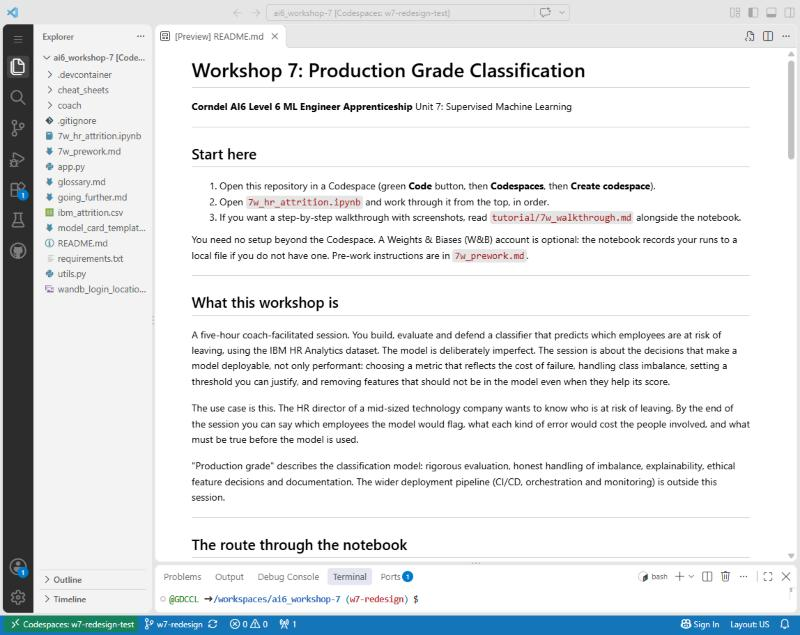

To check the environment, open a terminal (press Ctrl and J, then select **Terminal**) and run `python --version`. You should see Python 3.12.

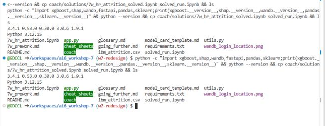

## 2. Open the notebook and choose the kernel

Open `7w_hr_attrition.ipynb`. The first cells give the title, the learning objectives, the use case and how to use the notebook.

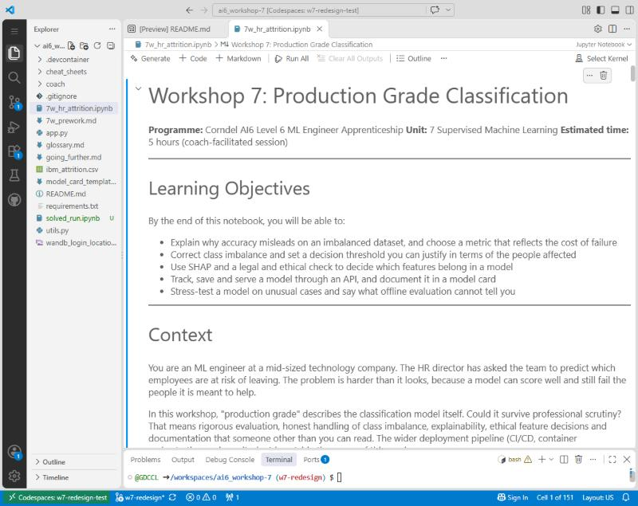

The notebook uses three coloured boxes. Yellow boxes are reminders, blue boxes ask you to reflect, and green boxes are tasks you complete. Hints and solutions sit under collapsible lines, so you can open them only when you need them.

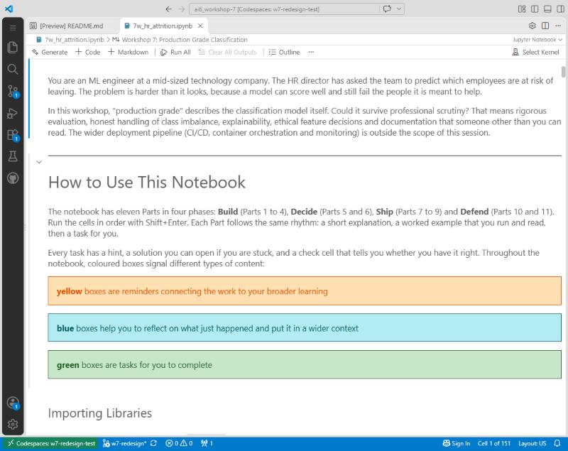

### Pick the right kernel

This is the step where learners lose the most time.

1. Select **Select Kernel** at the top right of the notebook.
2. Choose **Python Environments**.
3. Choose the entry labelled **Python 3.12** at `/usr/local/bin/python`.

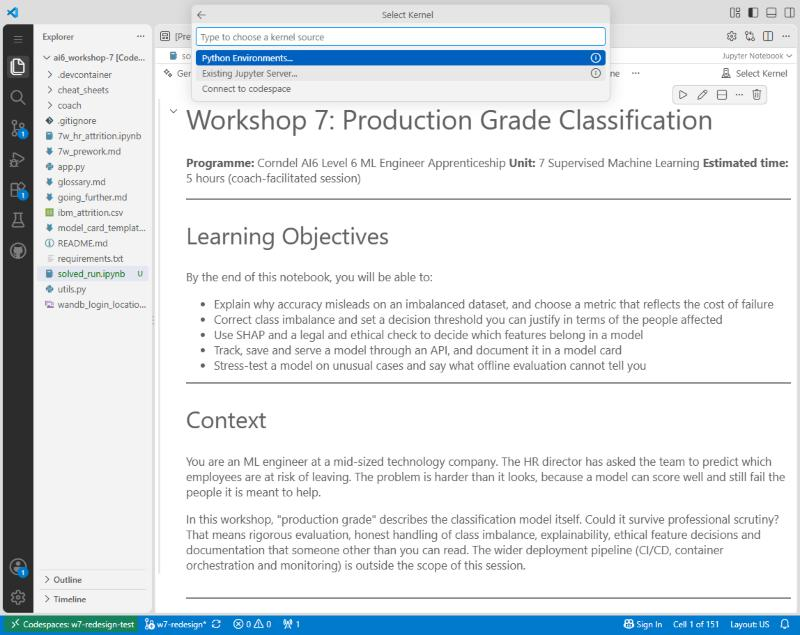

Do not choose **Create Python Environment**, even though the list marks it as recommended. It creates an empty environment without the workshop packages, and the first import cell fails.

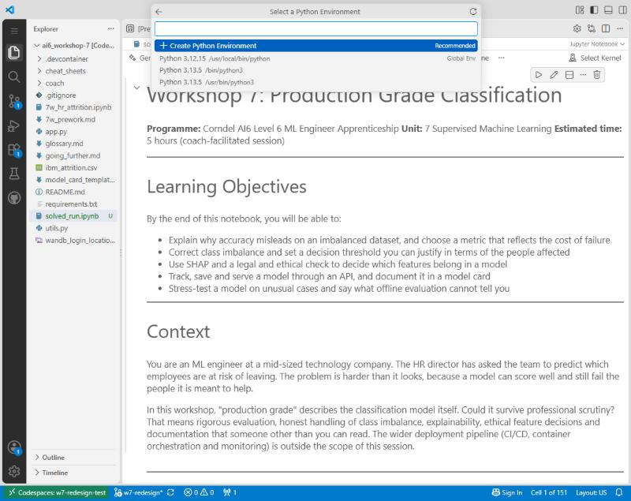

Run the **Importing Libraries** cell. It should finish without errors. The next cell, **Choose Where Your Runs Are Recorded**, asks whether to use W&B. Leave W&B off if you have no account. The notebook then records runs to `runs_log.csv`.

## 3. Part 1: Meet and prepare the data

Part 1 introduces the IBM HR Analytics dataset: 1,470 employees, of whom 214 (14.6%) left. You encode the target, then split the data into training, validation and held-out test sets.

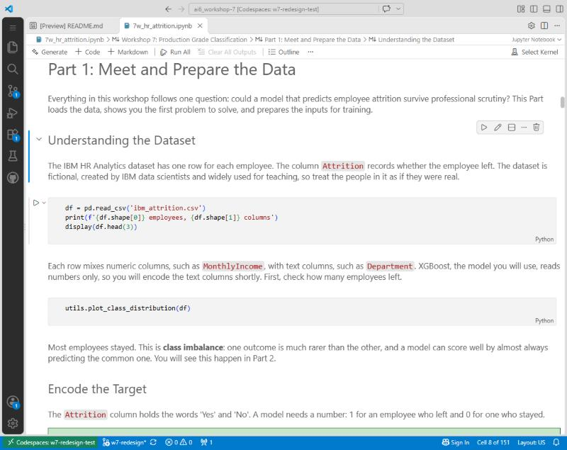

Each task has the same layout. You get a short brief, a hint, and a check cell that tells you whether your result matches what the next Part needs.

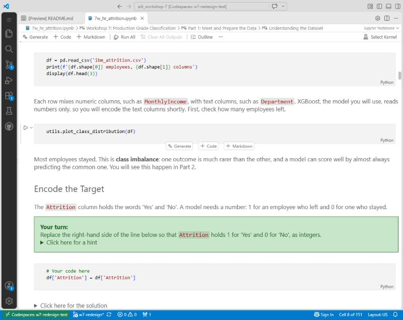

The notebook shows a Mermaid diagram of the three-way split. If it does not render, check that the Mermaid extension is installed. The devcontainer adds it for you.

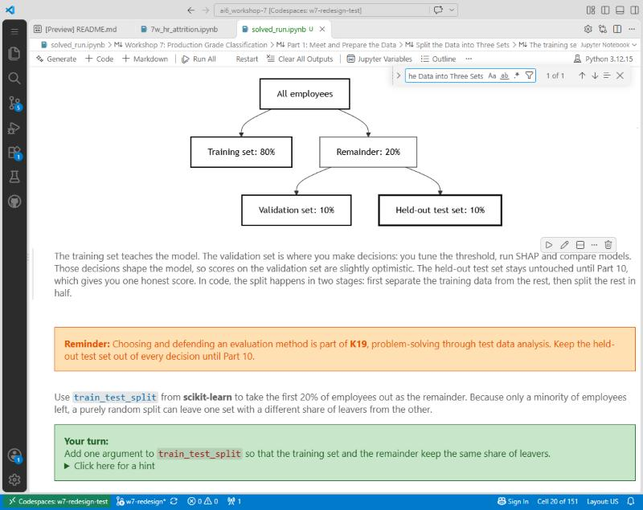

The split gives 1,176 training rows, 147 validation rows and 147 held-out test rows. The held-out set contains 21 leavers. You do not look at it until Part 10.

## 4. Part 2: The accuracy trap

You train a default XGBoost model and predict the validation set. Before you see the result, a blue box asks you to predict how accurate it will be. Write your prediction down, then run the cell.

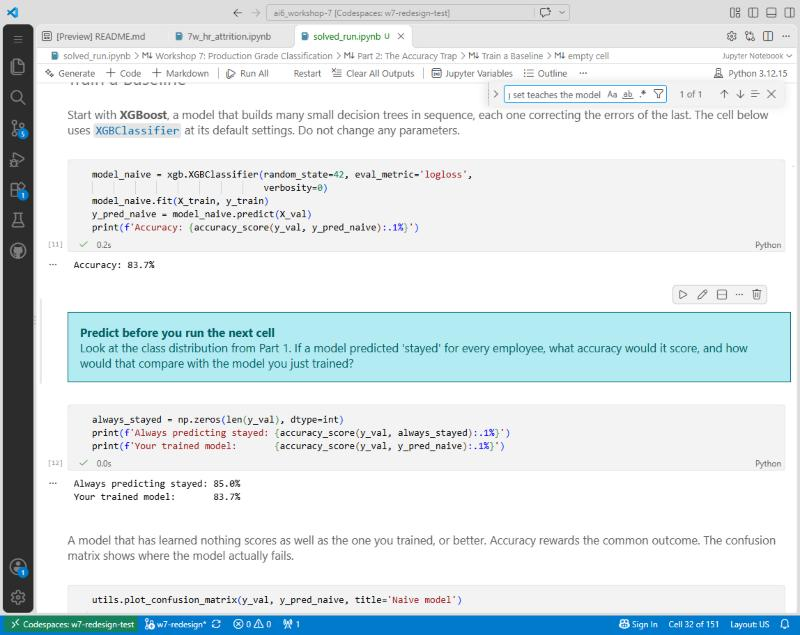

Accuracy looks high because most employees stay. The confusion matrix shows the cost: the model misses most of the people who leave.

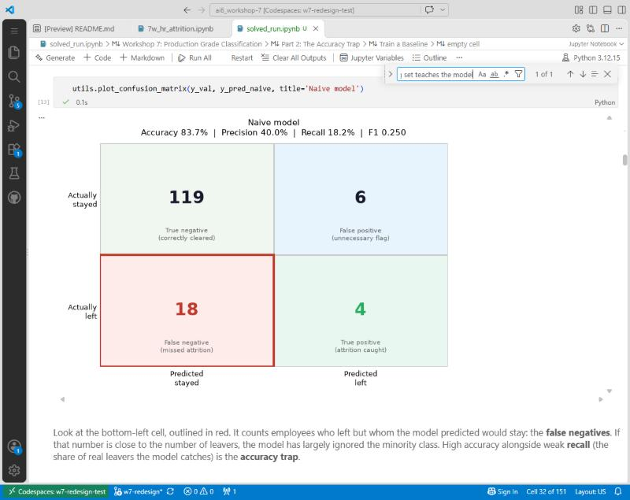

## 5. Part 3: Fix the class imbalance

You weight the minority class with `scale_pos_weight` and train a second model. A table compares the two models, and a sentence under it is computed from the numbers: it tells you what changed and by how much.

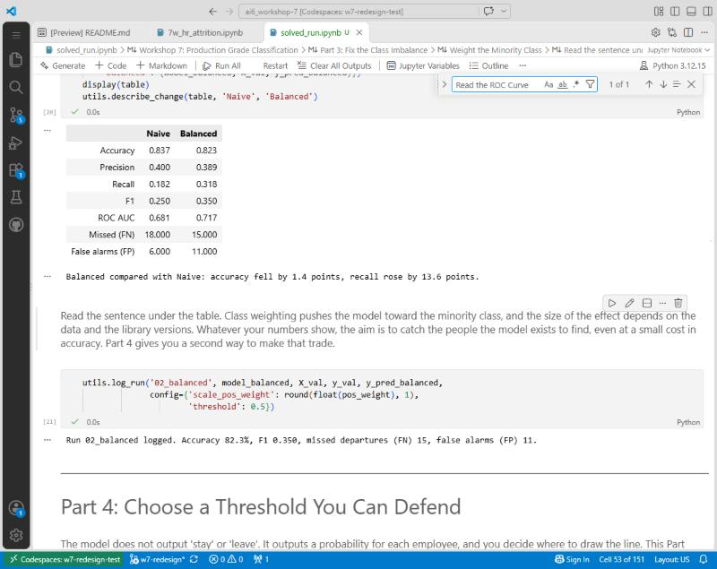

If the table shows no change in recall, that is a real result for your library versions, and the sentence says so. Do not edit the numbers.

## 6. Part 4: Choose a threshold you can defend

The ROC and calibration plots show how well the model ranks employees and how far its probabilities can be trusted.

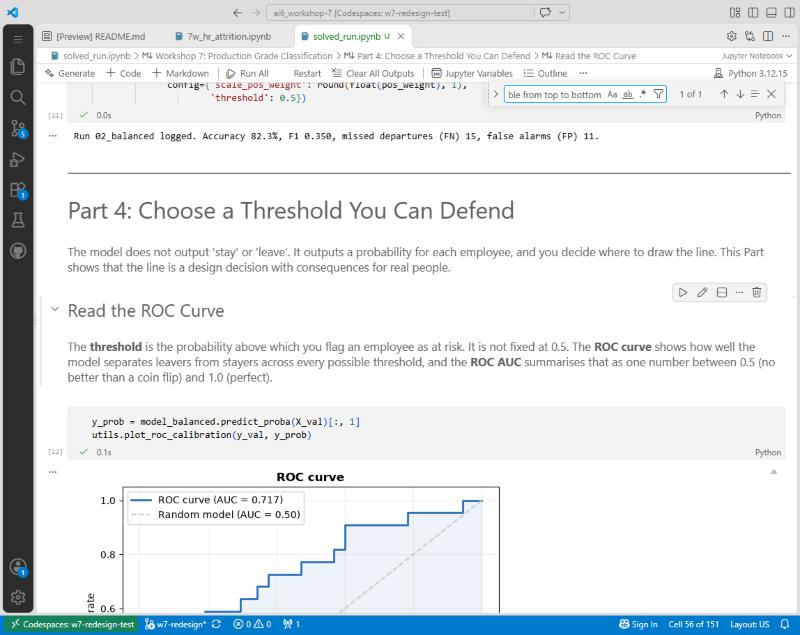

A threshold table then shows precision, recall and the number of employees flagged at each cut-off. Read the table as a trade-off between missed leavers and false alarms.

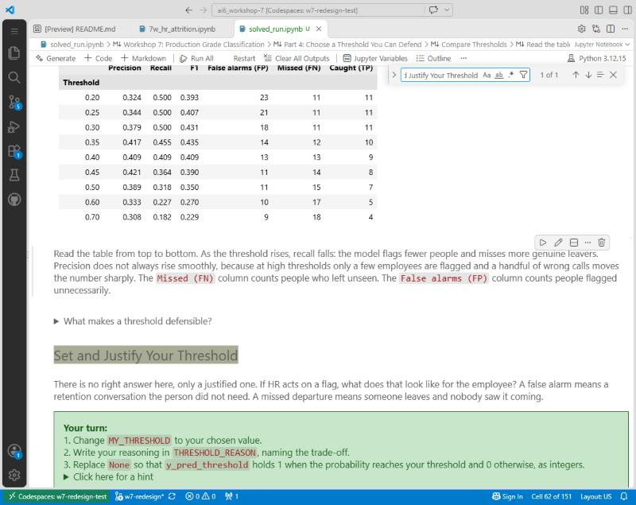

In the task you set `MY_THRESHOLD` and write one sentence that justifies it in terms of the people affected. The check cell reports whether your threshold and reason meet the task's requirements.

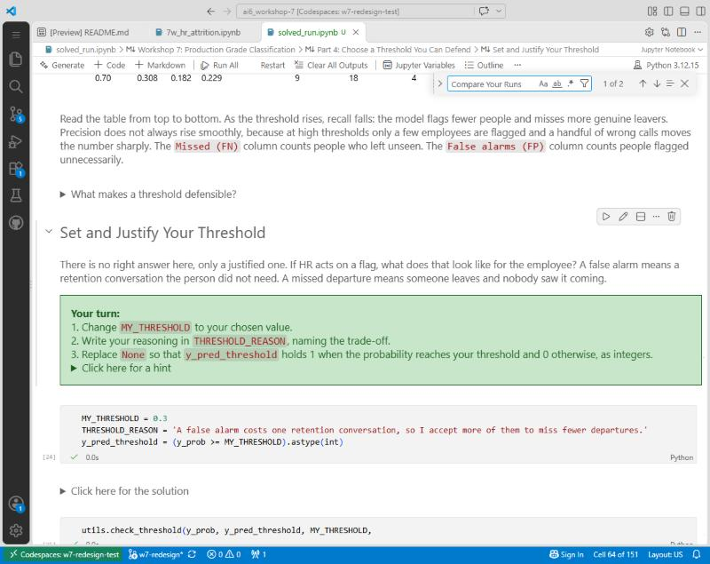

In the screenshot run, the threshold was 0.3.

## 7. Part 5: See inside the model with SHAP

The SHAP summary plot ranks the features by how much they move the model's predictions. A ranking table sits beside it.

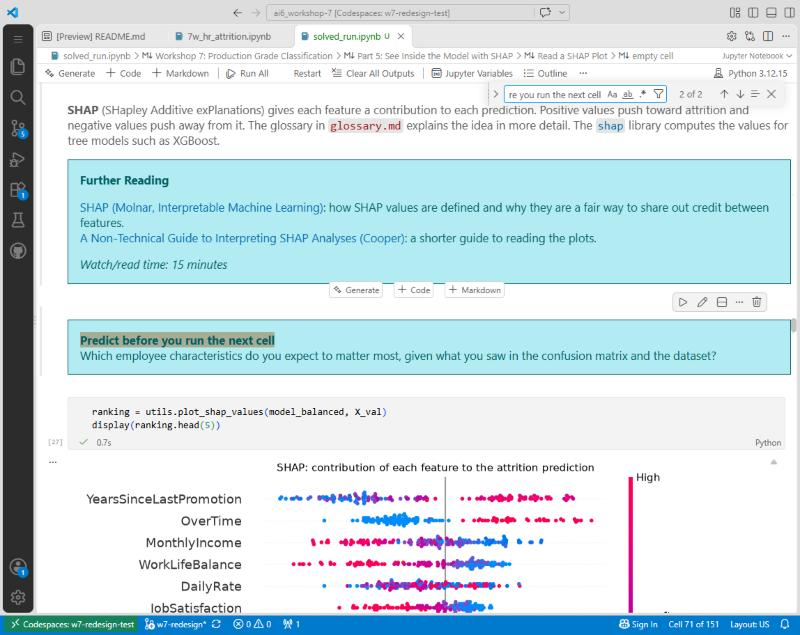

Look for features that you would not want to use to make decisions about people.

## 8. Part 6: Decide which features stay

You apply a three-question check to the top features and decide which to remove. Some features help the score but raise legal or ethical problems, for example features linked to protected characteristics. The notebook retrains the model without them and shows what you lose.

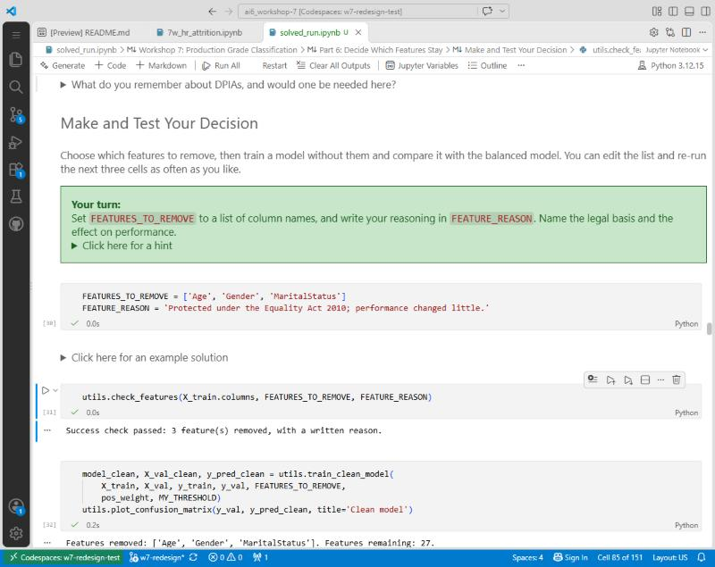

The legal wording in this Part is a teaching summary, not legal advice. Your coach can point you to your organisation's data protection lead.

## 9. Part 7: Track, compare and save your runs

Each model you trained was logged. The runs table lets you compare them side by side and pick the best one for the use case.

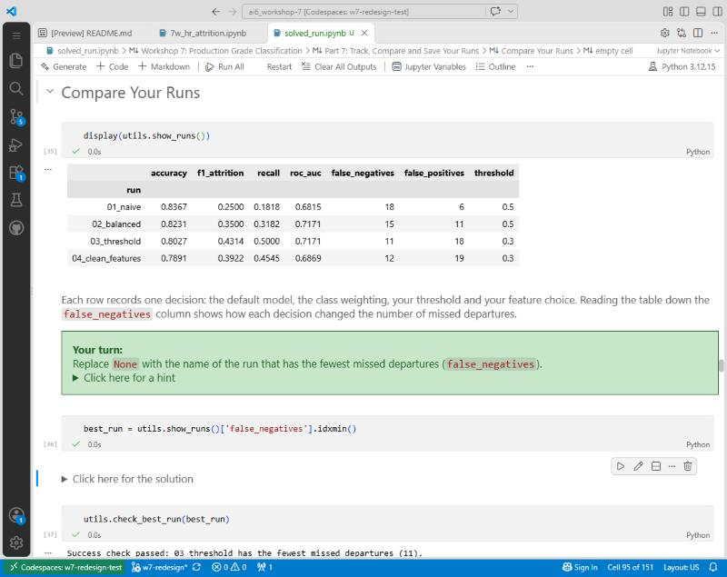

You then save the chosen model as `hr_attrition_model.joblib`, with its metadata in `model_meta.json`.

## 10. Part 8: Serve the model

Part 8 turns the saved model into an API. The notebook prints the working lines of `app.py` so that you can read them. The API loads the model, builds the input schema from the features the model was trained on, and exposes two endpoints: `/health` and `/predict`.

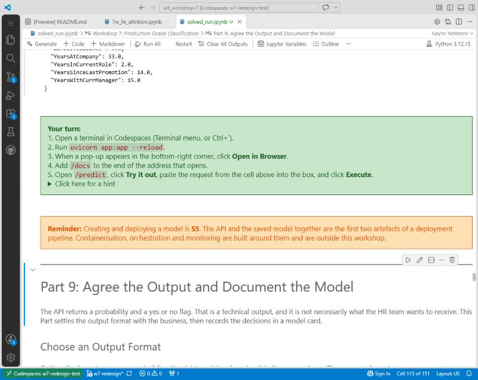

### Start the API

1. Open a terminal and run `uvicorn app:app --port 8000`.
2. Codespaces shows a notification that port 8000 is available. Select **Open in Browser**.

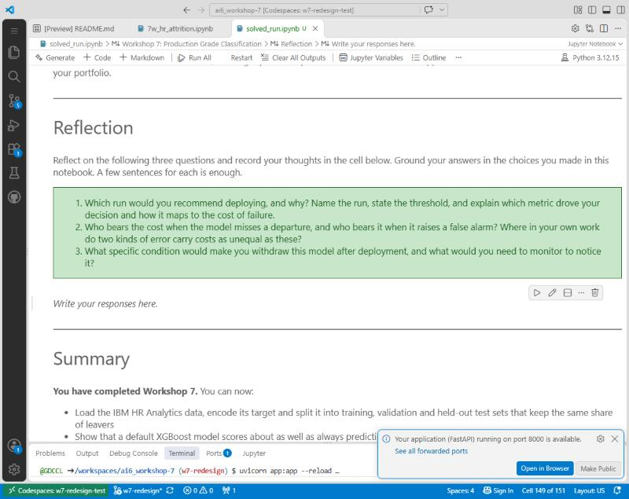

3. The root address returns `Not Found`. This is expected, because the API has no page at `/`.

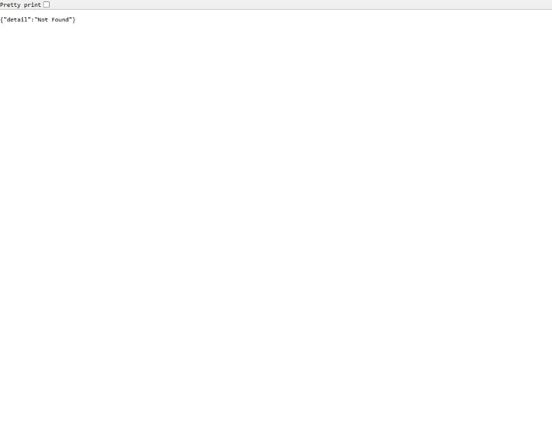

4. Add `/docs` to the address. This opens Swagger UI, which lists the endpoints.

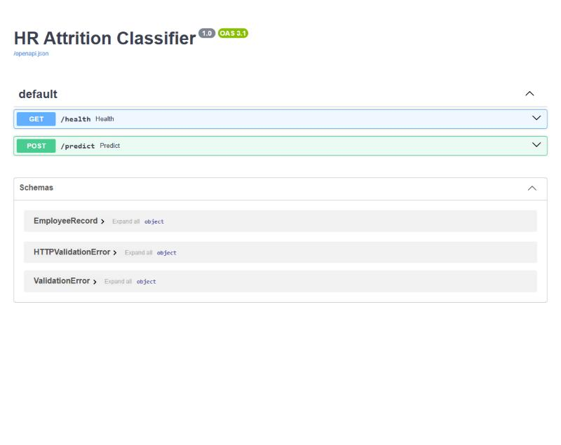

5. Open `POST /predict`, select **Try it out**, paste the example payload from the notebook and select **Execute**. The response gives the probability of leaving, the decision at your threshold and the threshold used.

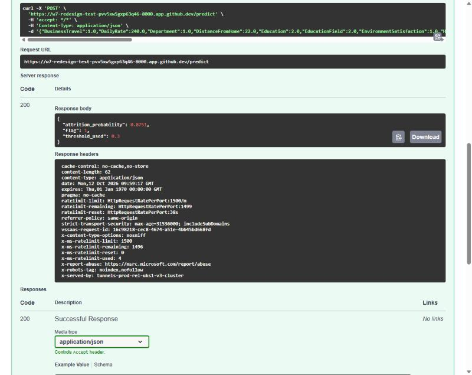

Stop the server with Ctrl and C when you have finished.

## 11. Part 9: Agree the output and document the model

You choose an output format for HR, for example a risk tier rather than a raw probability, and explain why. Then you create `model_card.md` from `model_card_template.md`.

A cell prints the numbers to copy into the Performance table. Open `model_card.md` in the file explorer, fill in the table, then add the features you removed, the output format and the limits of the model.

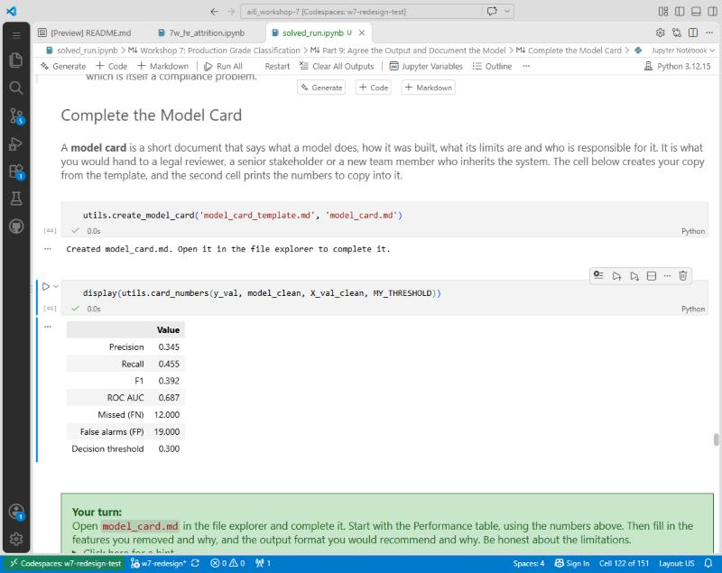

## 12. Part 10: Stress-test and evaluate the model

You look at real edge cases, ask a what-if question, then run the held-out test set once.

The edge-case table shows employees the model finds hard, for example people near the threshold or with unusual values.

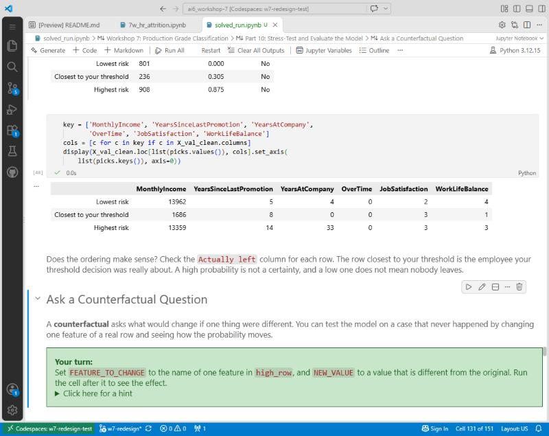

The what-if cell changes one feature for a high-risk employee and shows how the predicted probability moves. A change in probability shows association in the data. It does not show that changing the feature would change what the employee does.

The final evaluation compares the held-out result with the validation result. The held-out set is small, so a gap between the two is a warning about uncertainty, not a precise measurement.

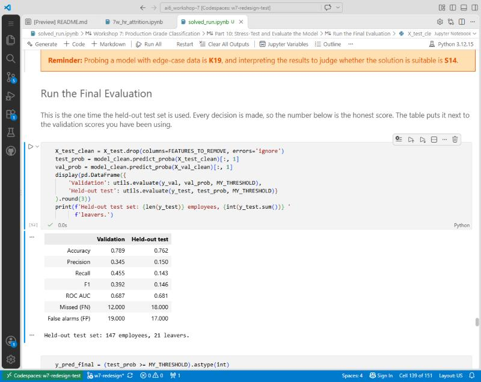

## 13. Part 11: Hand over the model

The independent task asks you to complete a deployment gate with three checks, each with a check, an owner and a halt condition. You also complete three slide fields: the problem and headline result, the metric, threshold and features removed, and the output format, oversight and accountability. A halt condition has to be specific and measurable, for example a recall below a stated value. The notebook rejects vague answers.

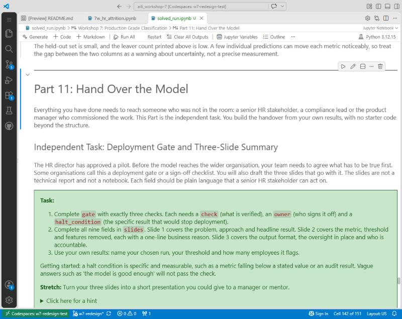

## 14. Reflection and summary

The reflection asks three open questions. Answer them in your own words, in the cell provided, before you read the summary.

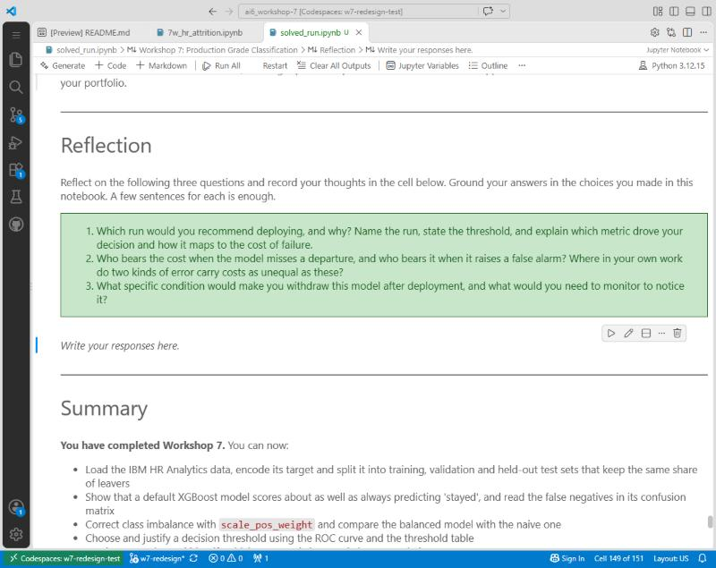

The summary lists what you built and what you decided, then points to the next workshop.

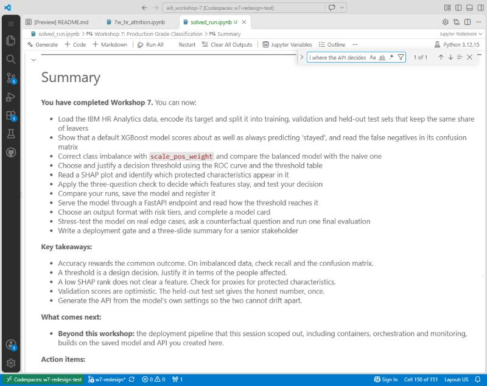

## Common problems

| Problem | What to do |
|:--|:--|
| The first cell reports `ModuleNotFoundError` | The wrong kernel is selected. Follow the kernel steps above and choose the `/usr/local/bin/python` entry. |
| The Mermaid diagram shows as plain text | Reload the window so the Mermaid extension loads. |
| `/` shows `Not Found` | Add `/docs` to the address. |
| The W&B cell asks for an API key | Leave W&B off, or paste the key from your W&B settings page. See `wandb_login_location.png`. |
| Your numbers differ from the screenshots | Expected. Library versions and random seeds change results. Check that your own interpretation sentences match your own tables. |
| The Codespace stops after inactivity | Reopen it from the Codespaces list. Your files are kept. Run the notebook again from the top. |

More help for coaches is in `coach/help.md`.
